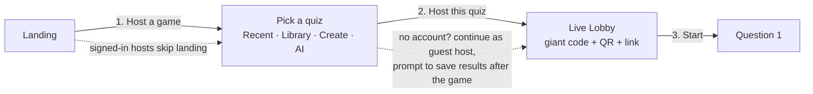
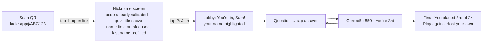
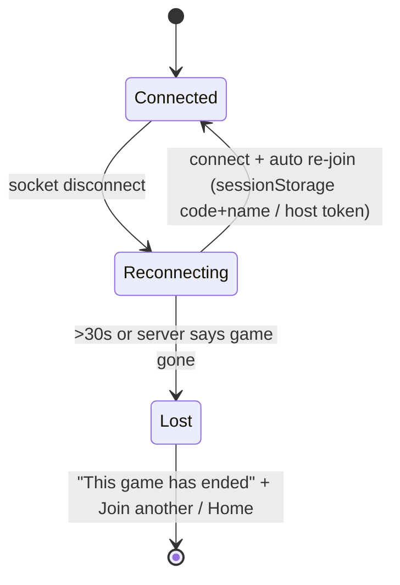

# 03 — UX Flow Audit (Host, Guest, Recovery, IA)

**Scope:** The full client (`src/`) and the Socket.IO server (`server/src/`), audited by reading the code only. Nothing was changed.
**North star:** *"It should be easy for the host to create a room and even easier for a guest to join. No guesswork should be involved on how to use the app as a host nor a guest."*
**Targets:** Host goes from landing to live lobby in **≤3 clicks**. Guest goes from QR scan to lobby in **≤2 taps**.

Severity: **P0** breaks the north star or loses users mid-game. **P1** is significant friction or confusion. **P2** is polish.

---

## 0. Executive summary

| Journey | Today | Target | Verdict |
|---|---|---|---|
| First-time host, no account → live lobby | **Not possible.** Signup is forced first. Best case is about 6 clicks + 4 form fields + a 1.8 s forced wait (Get Started → register → Browse Library → Use This Quiz → *auto-redirect* → Launch → Enter Host View) | ≤3 clicks | FAIL |
| Returning host (signed in) → live lobby | 2 clicks (Launch → "Enter Host View" modal) | ≤3 | PASS (could be 1) |
| Guest QR scan → lobby | Scan → page opens with the code filled in → tap Name → type → tap Join = **2 taps + typing**. The name field has no autofocus, and the page carries full marketing navigation | ≤2 taps | Borderline. Fix with autofocus, name-only screen, `/join/CODE` |
| Guest knows the answer was right or wrong | **Never told personally.** During reveal the player sees the same shared bar chart as the projector | Instant "Correct! +850" | FAIL (P0) |
| Guest after the game | "Back to Dashboard" → unauthenticated guest is bounced to `/login` | "You placed 4th · Play again / Host your own" | FAIL (P0) |
| Guest refresh / network blip mid-game | Player silently becomes a ghost spectator who cannot answer. No UI says so | Auto-rejoin with a "Reconnecting…" state | FAIL (P0) |
| Host refresh in lobby | Game is **deleted instantly**. Every guest is thrown to an empty "Final Results" podium. The host sees an empty lobby forever | Grace period + auto-restore | FAIL (P0) |
| IA | 15 routes. Two overlapping "browse" surfaces (Library, Marketplace). Teacher and student features mixed in one nav. Pricing promises gating that doesn't exist. Footer has 5 dead links | 4 top-level destinations | Sprawl |

**Top 10 fixes, in order of value per effort**
1. Personal answer feedback for players (correct/incorrect, points, rank) (P0, small).
2. Guest end screen: own rank + "Join another game" / "Host your own" in place of "Back to Dashboard" (P0, small).
3. Auto-rejoin: store `{code, name}` in `sessionStorage`, re-emit `player:join` on `connect`, show a "Reconnecting…" overlay (P0, small/medium).
4. Host lobby grace period: don't delete a lobby when the host's socket drops. Handle `host:reconnect:failed` (P0, medium).
5. Guest join: a `/join/:code` route, a name-only screen when the code is known, `autoFocus` on name, persistent nickname, a focused player shell (no marketing navbar) (P1, small).
6. Instant hosting: "Host this now" straight from Library, the landing page and the post-save screen (P1, medium). Guest-host mode for library quizzes, no account (P1, medium/large).
7. Host-controlled pacing: a "Next" button on reveal/leaderboard instead of a fixed 5 s auto-advance (the leaderboard is visible for about 0.5 s today) (P1, small).
8. Lobby essentials: kick player, copy link, bigger QR/fullscreen projector mode, unique-name enforcement, clean exit (P1, medium).
9. Fix the QuizBuilder/launch mismatch: empty choices pass client validation but are rejected by the server at **Launch** with "Invalid quiz data" (P1, small).
10. Collapse the IA: merge Library + Marketplace into "Discover". Split teacher and student surfaces. Remove dead footer links. Settle the brand (P1, medium).

---

## 1. Ideal flows

### 1.1 Host: target ≤3 clicks, landing → live lobby



Rules:
- **No modal between "Host" and the lobby.** Today's "Game Ready!" modal (`Dashboard.tsx` quick-launch) duplicates the lobby's QR/code and adds a click. If the modal is closed with Cancel, the server game is left orphaned.
- **Account is deferred**, not forced. Host a library or sample quiz anonymously. Ask for an account at the moment of value: "Save these results / build your own quiz."
- Every quiz surface (dashboard card, library card, marketplace card, builder save) has one primary verb: **Host**.
- QuizBuilder: **"Save & Host"** primary, "Save" secondary.

### 1.2 Guest: target ≤2 taps, QR → lobby



Rules:
- QR encodes a short path deep link `/j/ABC123` (or `/join/ABC123`), not `/join?code=`.
- When the code is known, **validate it on page load** (new `game:peek` event). Show the quiz title, or a precise error ("This game has ended" / "already started"), *before* the guest types a name.
- Name input: `autoFocus`, `enterKeyHint="go"`, `autoComplete="nickname"`, `maxLength=30` (matches the server), prefilled from `localStorage`. Returning players = **1 tap**.
- Manual code entry: `inputMode="text"`, `autoCapitalize="characters"`, `autoCorrect="off"`, `spellCheck=false`, `maxLength=6`, display as `ABC 123`, auto-advance when 6 valid characters are typed. The alphabet excludes I/O/0/1, so hint "letters and numbers, no O or I".
- The player shell hides the marketing navbar and footer.

### 1.3 Recovery (all roles)



---

## 2. Journey 1 — First-time visitor → understands value → hosts first game

### 2.1 Landing (`src/pages/Landing.tsx`)
**What exists:** a purple hero with a join-code input + "Join Now", "or", "Create Your Own Quiz" (→ `/register`), a QR that links to `/demo`, then 6 feature cards, 4 "How It Works" steps, K-12 categories (→ `/library?subject=`), a stats band, and a CTA band.

Friction:
- **P1 The hero tries to serve two audiences equally.** The join input and "Create Your Own Quiz" compete. Guests rarely land here (they arrive by QR/link). The hero should lead with **Host a game free** and keep a compact "Have a code? [______] Join" strip.
- **P1 "Create Your Own Quiz" goes to `/register`.** The first host action is a 4-field signup (name, email, password, confirm password). Step 1 of "How It Works" is literally "Create an Account". That contradicts "easy for the host".
- **P1 There's no instant "play a real game now".** The hero QR points to `/demo`, a **single-device simulation** with fake players (`Demo.tsx`). A visitor who scans that QR with a phone gets a split host+student layout on a phone. The right move is a **real** sample room hosted on the visitor's screen, which their phone can join. That demonstrates the actual value: multiplayer, live, on your own device.
- **P1 Fabricated social proof:** "10,000+ Quizzes Created", "50,000+ Players", "500+ Schools", "4.8/5" are hard-coded. This is a trust and legal risk. Remove it or source it from real data.
- **P2 Hero copy:** "Get Ready for a PopPop! Quiz!" says nothing about what the product does. Suggested: "Live quizzes your class can join in 5 seconds. No app, no accounts for players."
- **P2 Feature icons** are letter pairs ("RT", "QR", "LB", "SV", "TM", "MB"). Screen readers announce them as text. Use real icons with `aria-hidden`.
- **P2** The hero join input has `maxLength={6}`, but `/join` itself has no max. Inconsistent.
- **P2 Brand:** the UI says "PopPop!" (Navbar, Landing, Demo, `index.html` title). Code, logs and the repo say "Ladle". ROADMAP uses both. Settle it before any marketing.

Accessibility: the hero join input has an `aria-label` (good). "or" is a bare `<p>`, fine. Category cards are `Link > Card` with an inline `textDecoration` style. Focus outlines need verification.

### 2.2 Register / Login (`Register.tsx`, `Login.tsx`)
- **P0 Login ignores the return destination.** `ProtectedRoute` saves `state.from`, but `Login.tsx` always runs `navigate('/dashboard')`. Library/Marketplace "Sign in to Use" also call `navigate('/login')` with no state. **The user loses the quiz they picked.**
- **P1** Register asks for "Confirm Password". That's a redundant field. Use show/hide instead.
- **P1** Google is a **ghost** button below the form, and email is the `secondary` style. For a teacher audience, Google/Microsoft SSO should be the primary path, at the top.
- **P1** There's no "Forgot password?" on Login (grep finds none). That's a dead end for returning hosts.
- **P2** There's no role question ("I'm a teacher / student"). That's why student features (My Progress) end up in the teacher nav (see §6).
- **P2** Errors render as a `<p class="auth-error">` with no `role="alert"`, so screen readers don't hear them.

### 2.3 Dashboard first run (`Dashboard.tsx`)
- **P1 The empty state offers only "Create Your First Quiz".** The fastest path (a library quiz) is a secondary header button, "Browse Library". The empty state should offer three equal starts: **Host a sample quiz now** · **Pick from library** · **Create / generate with AI**.
- **P2** The subtitle "You have not created any quizzes yet." duplicates the empty-state heading.

### 2.4 Library → host (`Library.tsx`)
Click count for a signed-in user: **Use This Quiz** (1) → banner + **forced 1.8 s `setTimeout` redirect** to the dashboard → find the new card among all quizzes → **Launch** (2) → modal **Enter Host View** (3). Signed-out users add Sign in → login → (context lost) → dashboard → re-find the library → …
- **P1** The primary verb is "Use This Quiz", which really means *copy to my account*. Users want **"Host now"** (copying can happen silently), with "Copy & edit" as secondary.
- **P1** The auto-redirect after copying is disorienting and can't be cancelled.
- **P1 Seed controls are user-facing**: "Sign in to seed" and "Seed" buttons appear in error/empty states. Admin tooling is leaking into the UX.
- **P2** The preview modal has no `role="dialog"`, no Escape, and no focus trap.

### 2.5 Demo (`Demo.tsx`)
- A self-contained simulation with 4 hard-coded questions and fake players. It's useful as a 20-second explainer, but **it is not a game**, and its CTAs push to `/register`. Recommend reframing it as "See how it works (30s)". Make the primary hero CTA a real sample room.
- **P2** Mobile: breakpoints exist at 900/600 px, but a host+student split on a phone is conceptually confusing.

---

## 3. Journey 2 — Host: dashboard → live game → results → play again

### 3.1 Dashboard quiz cards
- Card actions: **Launch · Assign · Edit · Delete**. That's 4 equal-weight `size="sm"` buttons (~32 px tall, below the 44 px tap target). Delete is a red button **next to** Launch, which makes misclicks likely. Move Delete into an overflow "⋯" menu.
- **P1** "Launch" vs "Assign" is jargon for a first-timer. Use **Host live** vs **Assign as homework**, with a one-line tooltip.
- **P1** The header has 3 buttons (Browse Library, Assignments, Create New Quiz) plus the navbar's "Create Quiz". Duplicated entry points.
- **P1 Cold-start wait:** "Connecting to game server — this may take up to 30 seconds if the server is waking up…". That's honest, but it shows a free-tier hosting problem to users. Pre-warm the socket on dashboard mount (the socket already auto-connects, so show live connection status early instead of on click).
- **P2** "Played N times" and the category chip are low-value on a card. Better: last hosted date and number of questions.
- **P2** "Recent Games" / "Assignments" sections are below the fold and only appear when non-empty. Fine.

### 3.2 Quick Launch modal (`Dashboard.tsx` `quickLaunch`)
- **P1 Remove it.** It duplicates the lobby (QR + code + domain). It costs 1 click. **Cancel / overlay-click orphans a live server game** (the server keeps it until the 1 h idle cleanup).
- **P2** No `role="dialog"`, no Escape, no focus management.

### 3.3 Lobby (`Game.tsx`, lobby branch)
**What exists:** "Game Lobby" heading, a "You are the Host" badge, a QR (180 px) of `/join?code=X`, "or go to <origin>/join", the game code, a player list with **"0 pts"** per player, a team-name input + "Enable Teams", and a Start button ("Waiting for Players..." / "Start Quiz (N players)").

| Issue | Sev |
|---|---|
| **No kick/remove player.** Inappropriate nicknames can't be removed; the server has no kick event. | P1 |
| **No duplicate-name check** (`addPlayer`). Two "Alex"es. Name-based reconnect (`reconnectPlayer`) becomes ambiguous. | P1 |
| **Projector legibility:** the QR is 180 px and the code display is clamped at 3 rem inside a Card. For a classroom, the code should be about 10–15 vh, with an optional **fullscreen** button. The "or go to" domain line is 0.8 rem (`.lobby-join-domain`), unreadable from the back of a room. | P1 |
| **No "copy join link" / share** for remote/Zoom hosting. | P1 |
| **No way out.** The navbar is hidden on `/game/*` and there's no "Cancel game / Back" control. Closing the tab is the only exit, and it silently ends the game for everyone. | P1 |
| "0 pts" next to each player in the lobby is noise. Show avatars/names in big chips and a live count. | P2 |
| The team setup (free-text comma list) sits above Start, so every host sees an advanced option. Move it into a collapsed "Game options" with presets (2/3/4 teams, auto-named). | P2 |
| There's no game settings summary (question count, timer) and no sound/music toggle. | P2 |
| Start is enabled with 1 player. Fine. Copy: "At least 1 player must join before starting." OK. | — |
| The `?host=true` URL param drives the host UI client-side. The server verifies host actions, so this is cosmetic. But anyone opening a shared host URL sees host controls that silently do nothing. | P2 |

### 3.4 Question (host view)
- Good: the live "N / M answered" progress bar with `aria-live`, and Pause / +30s / Skip / End Game.
- **P1** The controls are `size="sm"` secondary buttons under the content, which is hard to hit on a tablet. Pause uses emoji glyphs (⏸ ▶) as labels.
- **P1** End Game uses `window.confirm`. Acceptable, but the copy should name the consequence: "End now? Players see final scores with N questions unanswered."
- **P2** The host view shows choices as tiles, but there's no question image/media support yet (see ROADMAP).
- **P2** There's no "everyone answered" moment. The server ends early automatically (good), but the UI gives no cue.

### 3.5 Reveal → leaderboard (shared screen)
- **P1 There's no host control over pacing.** The server auto-advances 5 s after `game:question:end` (`index.ts` `endCurrentQuestion`). The client spends 2 s on "correct", 2.5 s on "scores", then shows "leaderboard". That leaves the **leaderboard visible for about 0.5 s** before the 400 ms transition to the next question. The teacher can't pause to discuss the answer, which is the #1 classroom use. Add **Next ▶** (with optional auto-advance as a setting).
- **P2** "Next question coming up..." appears even after the last question.
- **P2** The scores phase lists *every* player. With 50 players this overflows. Cap at the top 5 plus "and 45 more".

### 3.6 Final podium → results → play again
- Host sees the podium plus "View Full Report" (appears only after the Firestore save resolves, so the button pops in late) and "Back to Dashboard".
- **P1 There's no "Play again"** (re-host the same quiz with the same players). Kahoot's most-used end action. The server deletes the game on end, so players would need to re-join. A "Play again" should create a new room and push a `game:redirect` to connected players.
- **P1** If the save fails, there's no message. The report button just never appears.
- **P2** `Results.tsx`: the report page also lacks "Host again" and an export (CSV).

---

## 4. Journey 3 — Guest

### 4.1 Entry points
| Entry | Lands on | Notes |
|---|---|---|
| QR in lobby | `/join?code=ABC123` | Code prefilled. Name empty (unless signed in). **No autofocus.** |
| Typed URL | `/join` | The lobby shows "<origin>/join" only, not a short memorable URL |
| Landing hero | `/join?code=` | Extra page hop: Landing → JoinGame → Game |
| `/join/ABC123` | **404 / blank** (no catch-all route; renders the layout with nothing) | P1: add the route plus a catch-all NotFound |
| `/game/ABC123` directly | Lobby rendered as a *non-player spectator* ("Waiting for the host…") | P1: no name, never joined, can't answer, no explanation |

**Tap count today (QR):** open link (1) → tap Name field (2) → type → tap **Join Game** (3). Enter on the keyboard can replace tap 3, giving **2–3 taps**. Proposed: open (1) → name already focused/prefilled → Join (2). Returning players: 1.

### 4.2 JoinGame screen (`JoinGame.tsx`)
- **P1** The full marketing **navbar + footer** render around the join card (Home, Try Demo, Join Quiz, Marketplace, Pricing, Sign In, Get Started). That's distraction and mis-tap risk for a 9-year-old on a phone.
- **P1** No `autoFocus`, `inputMode`, `autoCapitalize`, `autoCorrect="off"`, or `maxLength` on the code. The name has no `maxLength` (the server silently rejects names over 30 characters with a vague "Invalid game code or name provided.").
- **P1 Error messaging logic is convoluted.** A server error only renders when *both* fields are filled. Field errors use `error && !gameCode.trim()`, but the button is disabled when a field is empty, so those inline errors effectively never show. Messages:
  - Unknown/expired code → "Game not found. Please check the code and try again." It doesn't distinguish *ended* from *typo*.
  - Started → "This game has already started." No next step.
  - Full → "This game is full. Maximum players reached."
  - **An assignment code typed here** → "Game not found". Assignment codes use the **identical 6-character alphabet** (`generateAssignmentCode`), so students will confuse them. Fix: different formats (e.g. assignment `HW-XXXX`) **and** a server fallback: "That's a homework code. [Open assignment]".
- **P1 No timeout or connection state.** If the socket is cold or disconnected, `socket.emit` buffers and the button spins forever. (The dashboard has a 30 s handling; JoinGame has none.)
- **P2** Subtitle: "Enter the 6-character game code provided by your host". Fine. The hint "scan the QR code displayed on their screen" is shown *after* the user is already on the page. Remove it.
- **P2** A signed-in user's name is prefilled with the full `displayName` ("Edward Smith"). Offer the first name. Also, StudentDashboard progress matching uses the *first name*, so a mismatch silently saves the wrong entry (`Game.tsx` falls back to `leaderboard[0]`, **another player's score**). That's a data integrity bug (see §6.1).
- **P2** No nickname persistence (`localStorage`). There's no random-name generator for shy players or to avoid inappropriate names.

### 4.3 Lobby wait (player view)
- Shows the QR + code (useless to someone already joined, and it takes the top of a phone screen), the player list with "0 pts", and "Waiting for the host to start the quiz...".
- **P1** No "You're in, Sam!" confirmation. Your own name isn't highlighted. On mobile the player has to scroll past the QR to find the reassurance.
- **P2** No "Leave game" option. No fun idle content (avatar pick, etc.).

### 4.4 Answer → feedback
- Answer buttons: 4 large colored tiles with letter + text, `aria-pressed`, `aria-label`. Good. "Answer locked in — waiting for results..." Good. "Time is up!" Good.
- **P0 No personal feedback.** When `game:question:end` arrives, *all* clients switch to the shared reveal screen (`Game.tsx` reveal branch returns before the player branch). The player-specific `getChoiceState()` correct/incorrect styling is never shown. The player must find their answer in a bar chart. Players need: ✅ "Correct! +850 · streak 3" or ❌ "Not quite. The answer was B" · "You're in 5th place (↑2)".
- **P1** No haptic/sound feedback on tap. The 400 ms transition + `selectChoice` ignore taps during the transition with no visual cue.
- **P1 Contrast:** the yellow choice `#D69E2E` with white letters is about 2.3:1 (WCAG AA needs 4.5:1, or 3:1 for large text). Several dark-mode text colors use `rgba(255,255,255,0.4–0.5)` on dark purple (`Game.css` ~L593, 692, 728, 798, 836). Likely under 4.5:1.
- **P2** The timer is `aria-live="off"` (correct, avoids spam). Add a polite announcement at 5 s left.

### 4.5 Final rank → what next
- **P0 The guest sees the host's podium and a "Back to Dashboard" button.** For an anonymous guest that's a protected route, so they get redirected to `/login`. A dead end at the moment of peak engagement.
- **P1** The player's own rank isn't called out if they're outside the top 3 (they have to scan the "rest" list).
- Proposed: a "You placed **7th** of 24 · 4,320 pts · 3/5 correct" card. Then **[Join another game] [Host your own — free]**. Optional "Save your score (create account)".

---

## 5. Journey 4 — Recovery

| Scenario | What happens in code | What the user sees | Sev | Fix |
|---|---|---|---|---|
| **Guest refreshes during lobby** | Old socket disconnects → `handleDisconnect` deletes the player. The new page at `/game/CODE` only sends `lobby:request` (joins the room as a listener), **never `player:join`** | Their name vanishes from the host's list. They still see the lobby, as a ghost. When the game starts they see questions, but `recordAnswer` rejects their taps. **No message.** | P0 | Persist `{code,name}` in `sessionStorage`. On Game mount/`connect`, if not host, re-emit `player:join`. If the game has started, use the reconnect path. |
| **Guest refreshes mid-game** | Player marked `connected:false`. Rejoin only works if they manually go to `/join` and type the **exact same name** (`reconnectPlayer`) | Same ghost state. The "Connection restored — welcome back!" banner only renders in the *lobby* branch, so mid-game it never shows | P0 | Same as above plus a reconnect token (not name matching) |
| **Network blip (socket auto-reconnect)** | Socket.IO reconnects with a **new socket id**. Game.tsx re-emits only for hosts (`HOST_RECONNECT`). Players get no re-join | Taps silently do nothing. No "reconnecting" indicator anywhere (no `disconnect` listener in Game.tsx) | P0 | Global connection banner ("Reconnecting…" / "Back online") + auto re-join |
| **Host refreshes in lobby** | `handleDisconnect`: host in `lobby` → **`delete games[code]`** and emit `game:ended` to players | Players jump to the "Final Results" podium with an empty leaderboard + "Back to Dashboard". The host's reloaded page sends `host:reconnect` → `host:reconnect:failed`, **which the client doesn't listen for**. The host sees an empty lobby, "Waiting for Players…", forever | P0 | Treat the lobby like an active game: 90 s grace period. Client handles `host:reconnect:failed` → "This game ended. [Host again]". Players get "Host disconnected — waiting…" instead of a fake podium |
| **Host refreshes mid-game** | Kept alive for 90 s; `host:reconnect` restores the question state | Works for the `question` state. If the refresh happens during `reveal`, the snapshot carries `state:'reveal'`, which the client ignores. The host sees the lobby until the next question | P1 | Send and handle the reveal/leaderboard snapshot |
| **Host closes tab for >90 s** | `game:ended` emitted | Players see an empty "Final Results" podium. Misleading | P1 | A dedicated "The host ended the game" screen with scores so far |
| **Wrong code** | "Game not found. Please check the code and try again." | OK, but it's the same message for expired games and for homework codes | P1 | Distinguish ended / started / homework |
| **Visit `/game/BADCODE`** | `lobby:request` returns nothing | Lobby "Waiting for players to join..." forever | P1 | Server replies `lobby:not-found` → redirect to `/join?code=…&error=notfound` |
| **Server cold start** | Dashboard: 30 s message. JoinGame: infinite spinner | — | P1 | Shared connection-status component |
| **Socket listener hygiene** | `Game.tsx` cleanup calls `socket.off('connect')` with no handler, which removes **all** `connect` listeners app-wide (including `socket.ts` logging and any Dashboard `once` handlers) | Indirect bugs after leaving a game | P2 | Pass the handler reference to `off` |

---

## 6. Journey 5 — Secondary surfaces & information architecture

### 6.1 Per-surface notes
| Surface | Route | Coherent with the core loop? | Issues |
|---|---|---|---|
| **Library** | `/library` (public) | Yes, the best fast start | Not in the navbar at all. Reached only from landing categories or a dashboard button. "Use This Quiz" ≠ host. Seed buttons exposed. Login loses context |
| **Marketplace** | `/marketplace` (public, in nav) | Overlaps Library | Second browse surface with a different verb ("Fork", an engineering term) and different card UI. Merge into one **Discover** with a "Curated / Community" filter |
| **Assignments** | `/assignments`, `/assignment/:code`, `/assignment-report/:id` | A separate async mode | Desktop navbar omits Assignments (mobile menu includes it). Same code format as live games → confusion (see §4.2). The assignment link lives at `/assignment/CODE` while games use `/join?code=`. Two URL grammars |
| **AssignmentTake** | `/assignment/:code` | Good state machine (loading / enter-name / closed / already-submitted / error) | "Already submitted" is checked by **name** only, so the same name from different students collides |
| **Student "My Progress"** | `/my-progress` | Weak | Shown in the teacher's navbar. Requires the student to be signed in, but guests are never asked to sign in, so it's almost always empty. Progress is matched by first name with a fallback to `leaderboard[0]`, which **records another player's score** (`Game.tsx` GAME_RESULTS handler) |
| **Pricing** | `/pricing` | Misleading | Pro lists "AI question generation", "Async assignments", "Custom branding", "Unlimited quizzes", but **nothing is gated** in the client (no plan checks). Free says "Up to 10 quizzes", which isn't enforced. Either gate or rewrite |
| **Org/Brand Settings** | `/org-settings` | Low priority for most users | Top-level nav item labeled "Brand Settings" for every user. Belongs under Account → Settings. Success/error detection uses `message.includes('failed')`, which is fragile |
| **Results** | `/results/:id` | Good | No "Host again", no export |
| **Footer** | — | — | "How It Works", "Pricing", "FAQ", "Privacy Policy", "Terms of Service" all link to `/`. **Dead links**, and missing legal pages for a K-12 product is a compliance blocker (COPPA/FERPA). "Create Quiz"/"Dashboard" shown to logged-out users bounce to login |
| **404** | — | — | No catch-all route. Unknown URLs render an empty main area |

### 6.2 Navbar today (`Navbar.tsx`)
- Logged out (desktop): Home · Try Demo · Join Quiz · Marketplace · Pricing | Sign In · Get Started
- Logged in (desktop): Home · Join Quiz · Marketplace · Create Quiz · Brand Settings · My Progress | name · Sign Out
- Logged in (mobile): adds **Assignments** (missing on desktop). Logged-out mobile omits Pricing.
- Problems: 6 items for logged-in users, mixing host tools, student tools and admin settings. "Library" is missing. "Join Quiz" is prominent for hosts, who rarely join. "Home" for signed-in users = Dashboard but is labeled Home. No account menu. The navbar shows on `/join` (guest flow). Branding color override applies only to the navbar.

### 6.3 Recommended IA

```
PUBLIC (logged out)
  Logo → /
  [Host a game]  (primary)     → /host  (pick quiz; anonymous allowed for library/sample)
  Discover                      → /discover  (Library + Community merged)
  Pricing
  Sign in
  ── "Join a game" pill always visible top-right → /join

HOST (logged in)
  My Quizzes   (/dashboard: quizzes + recent games + assignments tabs)
  Discover     (/discover)
  Reports      (/reports: live game results + homework results)
  [+ New quiz] (primary button; opens Create / AI / Import chooser)
  Avatar menu → Account, Branding (Pro), Billing, Sign out

PLAYER SHELL (no navbar/footer)
  /join, /join/:code, /play/:code (game), /hw/:code (assignment)
  Minimal header: logo + "Leave" only

STUDENT (optional, logged-in learners)
  /me → My progress (shown only if account role = student)
```

Route consolidation: `/library` + `/marketplace` → `/discover`. `/assignments` + `/results/*` + `/assignment-report/*` → `/reports`. `/org-settings` → `/settings/branding`. `/game/:code` → `/play/:code` (separates the guest URL from host state, with the host controlled by server role rather than `?host=true`). Add `*` NotFound.

---

## 7. Screen-by-screen checklist (states, copy, a11y, mobile)

| Screen | Missing states | Copy | A11y | Mobile |
|---|---|---|---|---|
| Landing | — | Vague hero. Fake stats. Brand split | Letter "icons" read aloud | Hero QR is meaningless on phones (scanning your own screen) |
| Register/Login | No forgot password. No return-to | "Get Started" vs "Create Account" vs "Sign In" vs "Continue with Google". Inconsistent | Errors not `role="alert"`. Inputs lack `autoComplete` (email, new-password) | OK |
| Dashboard | Loading only for quizzes (recent games/assignments silently empty). No error if the quiz fetch fails | "Launch"/"Assign" jargon | Delete next to Launch. sm buttons <44 px. Modals not dialogs | The header button row (3 buttons) wraps awkwardly |
| QuizBuilder | No unsaved-changes guard. No "Save & Host" | "Make this quiz public" doesn't explain where it appears (Marketplace) | The correct-answer radio has no accessible label (`choice-radio-indicator` span only) | Long single page |
| QuizBuilder → Launch | **Empty choices pass `validate()` (≥2 filled is enough) but are sent unfiltered and rejected by the server schema (`min(1)` per choice) → "Invalid quiz data" only at Launch**. "Shuffle question order" is saved but never applied at launch | — | — | — |
| Quick-launch modal | Orphan game on Cancel | "Enter Host View" is jargon | No dialog semantics | — |
| Lobby (host) | No kick, exit, copy link, fullscreen | "Game Lobby" generic. "Enable Teams" unexplained | Team input unlabeled (placeholder only) | Host on a tablet: OK |
| Lobby (player) | No "you're in" state | — | — | QR occupies the fold on phones |
| Question (player) | No reconnecting state | Good | Yellow contrast | 4 large tiles. Good |
| Reveal | No per-player result | "Next question coming up..." on the last question | Low-alpha text contrast | Long score lists |
| Podium | No guest CTA. No save-failed state. "View Full Report" pops in late | "Back to Dashboard" for guests | — | — |
| JoinGame | No timeout/offline. No game preview | Error precedence logic hides messages | Input errors not linked via `aria-describedby`/`aria-invalid` (`Input.tsx`) | No keyboard hints. Navbar clutter |
| Library/Marketplace | Seed buttons. Lost context on login | "Use This Quiz" / "Fork" | Preview modal not a dialog (Library) | — |
| Pricing | — | Promises unenforced gates | — | — |
| Footer | Dead links | — | — | — |

---

## 8. Proposed acceptance criteria (for the implementation team)

1. A new visitor can reach a live lobby with a real sample quiz in **≤3 clicks with zero form fields**.
2. A guest scanning the lobby QR reaches "You're in!" in **≤2 taps** (1 for returning players). The name field is focused on load.
3. After every question, each player sees personal correct/incorrect, points and rank within 500 ms of reveal.
4. Refreshing or losing network as a player or host (lobby or mid-game) restores the session automatically within 5 s, with a visible "Reconnecting…" state. No ghost players.
5. A guest's final screen never links to an authenticated route.
6. Every error message states what happened and what to do next. There are no infinite spinners (max 15 s, then an actionable error).
7. All tap targets ≥44×44 px on player screens. All text meets WCAG AA contrast. All modals are `role="dialog"` with Escape + focus trap.
8. No dead links. No unenforced pricing claims. One brand name.
